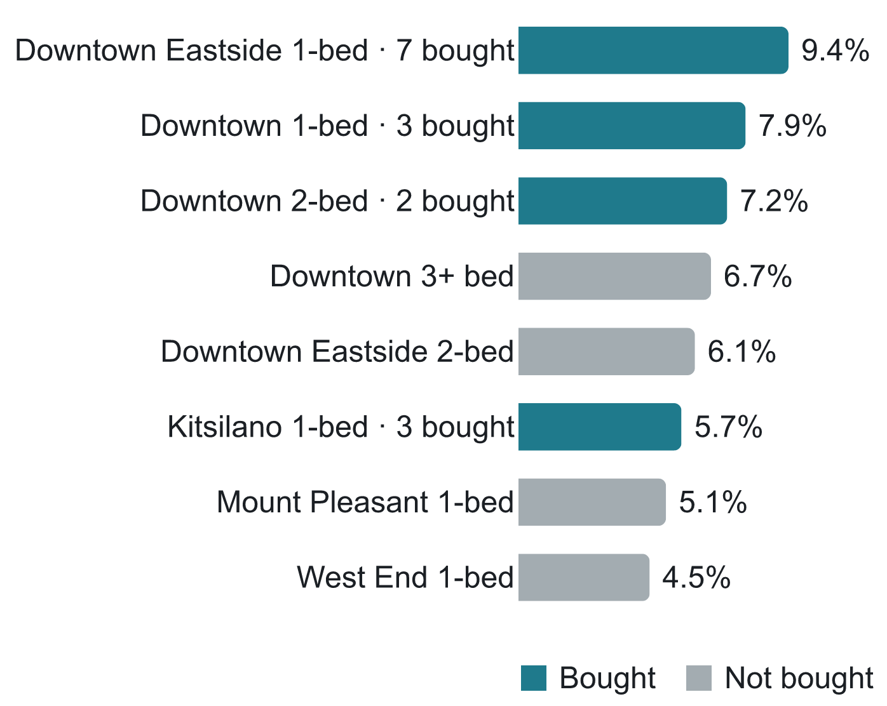

# Where to Put $10M in Vancouver Short-Term Rentals

🥉 **3rd place, DataJam 2026** · Team Douglas Gang

A data-driven investment recommendation built over one datathon weekend: given $10M, which Vancouver properties should a short-term-rental operator buy to maximise 2027 revenue?

**Answer:** buy 15 condos in Downtown Eastside, Downtown and Kitsilano for $9.87M. They are expected to earn about **$765K in revenue in 2027**, about 7.7% of the purchase price.

| Neighbourhood | Units | Price each | Revenue each / yr |
|---|---|---|---|
| Downtown Eastside | 7 × 1-bed | $524,875 | $49,140 |
| Downtown | 3 × 1-bed + 2 × 2-bed | $644,470 / $871,930 | $50,760 / $63,092 |
| Kitsilano | 3 × 1-bed | $840,565 | $47,511 |

📊 **Pitch deck:** [`presentation/DataJam_2026_Vancouver_Condo_Pitch.pdf`](presentation/DataJam_2026_Vancouver_Condo_Pitch.pdf)


📓 **Walkthrough notebook:** [`notebooks/analysis.ipynb`](notebooks/analysis.ipynb)



## The problem
A fictional operator (DDD) has $10M to buy properties in Vancouver that go live as Airbnb listings on 1 January 2027. Performance is judged on calendar-year 2027 revenue. Licensing and provincial registration rules still apply, and there is a mid-2027 regulatory risk because municipalities can opt out of the province's short-term-rental exemption.

## Approach
1. **Clean listings.** Keep active, short-term, whole-home Inside Airbnb listings and estimate annual revenue for each one.
2. **Price the properties.** Join City of Vancouver 2026 property assessments to neighbourhoods through parcel polygons. Condo values are scaled by bedroom count.
3. **Define options.** An *option* is a neighbourhood × property type × bedroom count. For each option, compute median revenue ÷ median price.
4. **Allocate.** Buy from the top of the ranking, with at most 40% of the budget in any one neighbourhood.

Operating costs aren't in the dataset, so the model ranks on gross revenue.

## Key decisions
| Decision | Why | Impact |
|---|---|---|
| **Condos only** | Houses earn similar revenue but cost 2–3× more | Best house yields 3.0%, while every trusted condo option yields 4.5%+ |
| **30+ listings per option** | A resampling test showed a median from 20 listings is typically ±17% off, and from 30 listings ±14% | Unreliable small-sample options are excluded |
| **Rank by revenue ÷ price** | Directly measures return on capital | 15 units / $765K, vs 13 units / $691K under the earlier cost-based ranking |

## Validation
- A resampling test sets the minimum sample size (`outputs/sample_size_test.csv`)
- A filter funnel records how many listings survive each cleaning step (`outputs/funnel.csv`, `outputs/filters.csv`)
- The allocation was hand-checked against the budget and the concentration cap
- Key choices were compared against alternatives, including house vs condo and ranking method

## Reproduce
```bash
pip install -r requirements.txt
bash scripts/download_data.sh            # Inside Airbnb listings + neighbourhoods -> data/raw/
python scripts/build_property_values.py  # optional: rebuild data/external/ from City of Vancouver Open Data
python run.py                            # -> outputs/
python presentation/make_charts.py       # -> presentation/charts/
```

## Project structure
```
├── run.py                     # entry point: runs the full pipeline
├── src/
│   ├── config.py              # every threshold and assumption in one place
│   ├── prep.py                # cleaning + per-listing revenue
│   └── final.py               # options, ranking, allocation, checks
├── scripts/                   # data download + property-value build
├── data/external/             # 2026 property values (+ provenance)
├── notebooks/analysis.ipynb   # step-by-step walkthrough
├── outputs/                   # allocation, options, summary + check tables
└── presentation/              # pitch PDF, charts, chart script
```

## Team — Douglas Gang
| Name | GitHub |
|---|---|
| Yohei Ono | @2005yoheiUBC |
| Koree Ko  | @corytoo |
| _Name_  | _@handle_ |
| _Name_  | _@handle_ |

## Tech
Python · pandas · NumPy · Altair · matplotlib · Jupyter

## Data & credits
- Data: Inside Airbnb, Vancouver, 15 June 2026, CC BY 4.0
- City of Vancouver Open Data: 2026 property tax report and property parcel polygons

Revenue and booking figures are Inside Airbnb estimates, not reported figures. No host names, listing URLs or licence numbers are stored or shown.

**AI use:** Claude helped write code, run analysis and draft slides. All numbers were verified by re-running the pipeline from this repo.
